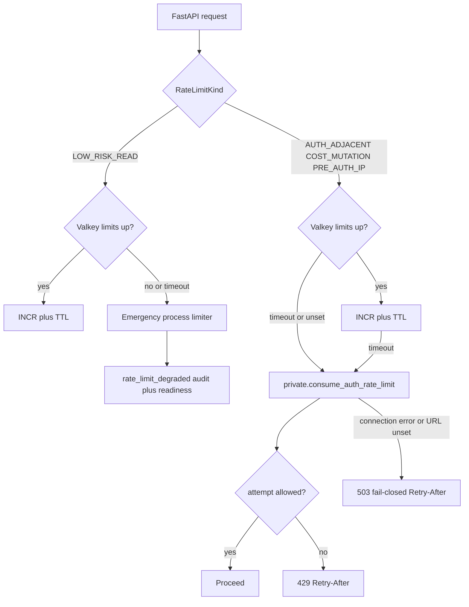

# Auth rate-limit ownership

Each Auth-sensitive operation has a **single owning throttle**. FastAPI must not
claim to protect browser-direct Supabase Auth traffic.

## Ownership matrix

| Operation class | Owner | Local dev behavior | Proof |
| --- | --- | --- | --- |
| Email/password sign-in, OAuth, password reset, MFA challenge | Hosted Supabase Auth controls / captcha (selected plan) | **Not enforced** by local Supabase CLI stack | Documented only; `local_auth_throttling_proven=False` |
| Invitation create/accept, offboarding (FastAPI-mediated) | FastAPI Valkey limits then Postgres `private.consume_auth_rate_limit` | Postgres when Valkey unset; dual failure 503 + Retry-After | `test_auth_rate_limits.py` |
| Query admission / chat starts / uploads / crawls / admin mutations | FastAPI COST_MUTATION or AUTH_ADJACENT | Same fail-closed path | Packet 1 + packet 5 tests |
| Authenticated low-risk reads | FastAPI Valkey; on Valkey loss per-process emergency limiter | Emits `rate_limit_degraded`; readiness degraded | `test_low_risk_read_emergency_limiter_is_audited` |
| Anonymous sign-in | Disabled (`enable_anonymous_sign_ins = false`) | N/A | `supabase/config.toml` |

FastAPI never throttles browser-direct Auth. The FastAPI limiter is a
different owner from hosted Auth.

## Valkey-loss policy

Mutations never skip the limiter. A test that observes a cost mutation
succeeding with both Valkey and Postgres unavailable is a failing defect.

Pre-auth IP burst uses a hashed `preauth-ip:` bucket on mutation prefixes.
When neither Valkey nor Postgres is configured the process is
**unconfigured** (not a dual outage of bound backends) and the pre-auth
middleware does not invent a silent allow of a bound limiter.

## Separate Valkey instances

Compose services `valkey-limits` and `valkey-cache` stay on the private
network with `requirepass` and no host ports (ADR-private-service-tls omits
TLS locally).

| Instance | maxmemory | mem_limit | policy | Key prefix |
| --- | --- | --- | --- | --- |
| valkey-limits | 64mb | 128m | `noeviction` | `limits:` |
| valkey-cache | 256mb | 320m | `allkeys-lru` | `cache:` |

64mb is 50% of 128m (≤ 70%). Every limits counter sets a TTL via `EXPIRE`
after `INCR`. Named ACL users and Secrets Manager rotation are Phase 10.

## Flags

| Flag | Meaning |
| --- | --- |
| `local_auth_throttling_proven` | **False** — local Supabase does not prove hosted Auth throttles |
| `hosted_auth_throttling_proven` | Requires managed-plan exercise in Phase 10 |

## Related documents

- [FASTAPI_SECURITY.md](../api/FASTAPI_SECURITY.md)
- [ADR-privileged-auth-administration-boundary.md](../adr/ADR-privileged-auth-administration-boundary.md)
- [ADR-private-service-tls.md](../adr/ADR-private-service-tls.md)
- [IDENTITY_PROPAGATION.md](./IDENTITY_PROPAGATION.md)
