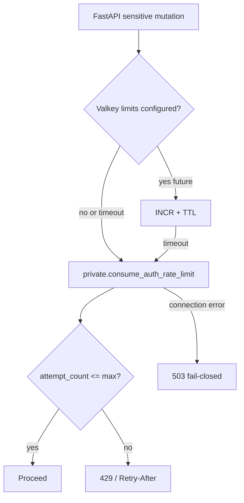

# Auth rate-limit ownership

Each Auth-sensitive operation has a **single owning throttle**. FastAPI must not
claim to protect browser-direct Supabase Auth traffic.

## Ownership matrix

| Operation class | Owner | Local dev behavior | Proof in Packet 4 |
| --- | --- | --- | --- |
| Email/password sign-in, OAuth, password reset, MFA challenge | Hosted Supabase Auth controls / captcha (selected plan) | **Not enforced** by local Supabase CLI stack | Documented only; `local_auth_throttling_proven=False` |
| Invitation accept (FastAPI-mediated) | FastAPI → optional Valkey → Postgres `private.auth_rate_limit_buckets` | Postgres degraded path when Valkey unset | `test_auth_rate_limits.py` |
| Query admission (Phase 6 packet 1 slice) | FastAPI Postgres `query-admission:{user_id}` then durable admit RPC | Does **not** throttle hosted Auth. 429/unavailable insert no reservation | `test_query_run_admission.py` |
| Upload/crawl/chat/admin mutations (later phases) | FastAPI Valkey fast path + Postgres fallback | Same degraded Postgres path | Documented contract; chat router in Phase 6 packet 5 |
| Anonymous sign-in | Disabled (`enable_anonymous_sign_ins = false`) | N/A | `supabase/config.toml` |

## Degraded Postgres path

Atomic counter lives in `private.auth_rate_limit_buckets`. Only FastAPI-owned
code with `app_api` executes the RPC.

## Flags

| Flag | Meaning |
| --- | --- |
| `local_auth_throttling_proven` | **False** in local contract tests — local Supabase does not prove hosted Auth throttles |
| `hosted_auth_throttling_proven` | Requires managed-plan exercise in Phase 10 |

## Related documents

- [ADR-privileged-auth-administration-boundary.md](../adr/ADR-privileged-auth-administration-boundary.md)
- [IDENTITY_PROPAGATION.md](./IDENTITY_PROPAGATION.md)
