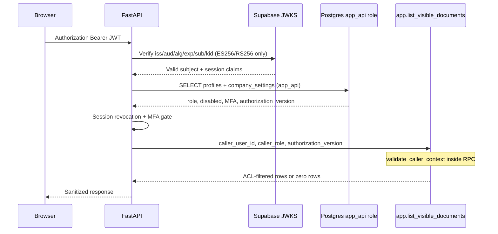
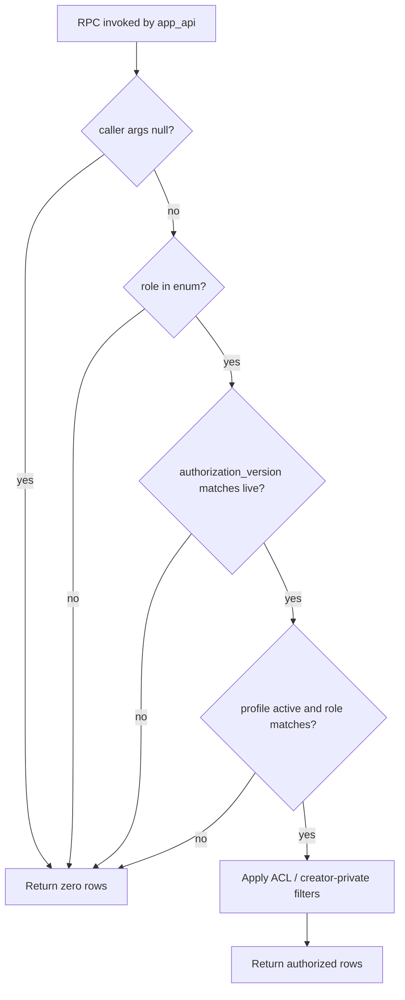
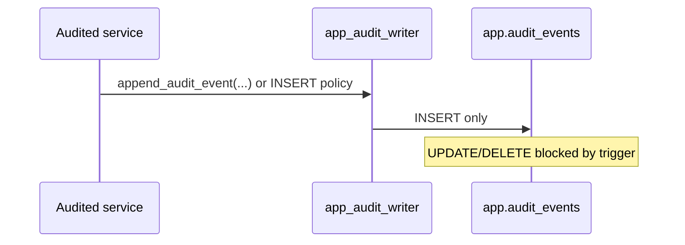

# Identity propagation

FastAPI → Postgres identity is **explicit**, **typed**, and **transaction-pool safe**. Connection reuse must not leak caller identity between requests.

## Sequence: authenticated read via RPC

## CallerContext (core)

`packages/core/src/smart_rag_core/security/identity.py` defines the frozen Pydantic contract:

| Field | Source | Trusted from client? |
| --- | --- | --- |
| `user_id` | Verified JWT `sub` + profile FK | **Never** |
| `role` | `app.profiles.role` | **Never** |
| `authorization_version` | `app.company_settings.authorization_version` | **Never** |
| `session_id` | JWT session claim (Packet 4) | **Never** |
| `disabled` | `app.profiles.disabled_at` | **Never** |
| `upload_enabled` | `app.profiles.upload_enabled` | **Never** |
| `mfa_enrolled` | `app.profiles.mfa_enrolled` | **Never** |

FastAPI dependency: `apps/backend/src/smart_rag_api/dependencies/identity.py`.

- Reads `Authorization: Bearer` and verifies through
  `packages/core/src/smart_rag_core/security/jwks.py`.
- Loads profile + company settings via `app_api` Postgres reads.
- Rejects disabled users, revoked sessions, and missing MFA for
  owner/admin/upload-capable members.
- `APP_ENV=test` may use `X-Test-*` headers; production never trusts client role
  metadata.

Privileged Auth Admin (`service_role`) lives only in
`apps/backend/src/smart_rag_api/auth_admin/` per
[ADR-privileged-auth-administration-boundary.md](../adr/ADR-privileged-auth-administration-boundary.md).

## Revocation and lifecycle changes

MFA recovery and offboarding both update `profiles.session_revoked_at`. A token
whose verified `iat` is at or before that timestamp is rejected even if provider
access-token expiry has not elapsed. Exact `session_id` rows remain an additional
denial path. Provider global logout revokes refresh sessions but is not treated
as immediate access-token invalidation by itself.

Security-sensitive profile changes (`role`, `disabled_at`, `upload_enabled`, or
`mfa_enrolled`) bump `company_settings.authorization_version`. Previously loaded
caller snapshots then fail inside typed RPC validation. Lost-factor initiation
sets `mfa_enrolled=false` and `upload_enabled=false`; provider factor deletion
and global logout must succeed before the request is marked complete. Restoring
upload capability still requires a newly enrolled factor and an AAL2 session.

Offboarding performs only Phase 2 security effects: provider logout, disabled
profile, capability removal, session timestamp, authorization-version bump, and
audit. Export and purge remain later-phase work.

## Transaction pooling rules

| Path | Pool mode | Identity mechanism |
| --- | --- | --- |
| API RPC reads/writes | transaction (Supavisor) | RPC **arguments** only |
| LangGraph checkpointer | session/direct | dedicated `app_checkpointer` role |
| LightRAG storage | session/direct | dedicated `app_lightrag` role |
| Worker queues | transaction | job lease owner + worker role grants |

**Forbidden on transaction-pooled API paths:**

- `set_config('request.jwt.claims', …)` or other session GUC identity
- trusting client-supplied role, ACL, or authorization snapshot headers in production
- prepared statements that bind identity at prepare time without per-call validation

## Hybrid retrieval transactions (Phase 4 Packet 2)

Dense and term retrieval open one Postgres transaction through
`retrieval_transaction` in `packages/core/src/smart_rag_core/retrieval/session.py`:

1. Require an idle connection (no leftover in-transaction GUCs).
2. `BEGIN`, then `SET LOCAL ROLE app_api`.
3. `SET LOCAL` HNSW, `work_mem`, statement timeout, and trigram threshold.
4. Call `SECURITY INVOKER` RPCs with server-derived `CallerContext` only.
5. `COMMIT` or `ROLLBACK` so role and GUCs cannot leak to pooled reuse.

Caller IDs are never client parameters. PostgREST/`anon`/`authenticated`/
`service_role` are not granted retrieval `EXECUTE`. ParadeDB BM25 IDs are
rechecked in the same authorization transaction before they can leave the
adapter. Tunables and negatives live in
[HYBRID_RETRIEVAL_CONTRACT.md](../retrieval/HYBRID_RETRIEVAL_CONTRACT.md).

## RPC validation flow

Live version is always read inside the RPC transaction from `app.company_settings`.

## Pool reuse safety test (Packet 3)

The local contract reuses one physical PostgreSQL backend across two committed
transactions. Request A deliberately leaves a `request.jwt.claims` GUC naming
user A on the session. Request B then passes user B through the typed RPC
arguments and proves user A's restricted document remains hidden; missing,
forged, disabled, and stale arguments also return zero rows. This is a local
driver/SQL boundary proof, not a production Supavisor load claim.

Phase 9 owns concurrent Supavisor load testing. It must preserve the same
argument-bound behavior and cannot replace this deterministic local denial
contract with a session-GUC convention.

## Audit writer path

## Related documents

- [AUTHORIZATION_MODEL.md](./AUTHORIZATION_MODEL.md)
- [HYBRID_RETRIEVAL_CONTRACT.md](../retrieval/HYBRID_RETRIEVAL_CONTRACT.md)
- [05-database-connections.md](../architecture/05-database-connections.md)
- [Phase 2 evidence](../development/phase-02-identity-data-evidence.md)
- [Phase 4 evidence](../development/phase-04-hybrid-rag-evidence.md)
