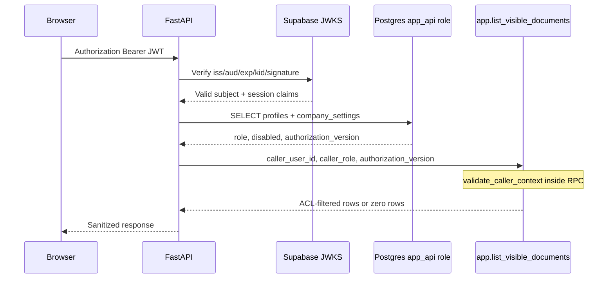
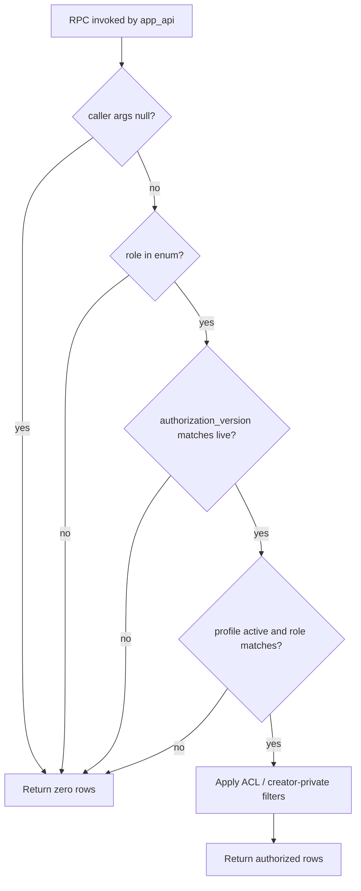
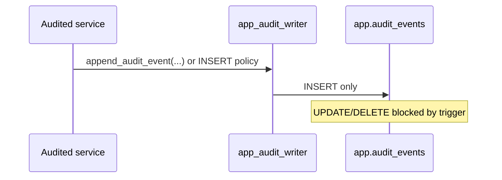

# Identity propagation

FastAPI → Postgres identity is **explicit**, **typed**, and **transaction-pool safe**. Connection reuse must not leak caller identity between requests.

## Sequence: authenticated read via RPC

## CallerContext (core)

`packages/core/src/smart_rag_core/security/identity.py` defines the frozen Pydantic contract:

| Field | Source | Trusted from client? |
| --- | --- | --- |
| `user_id` | Verified JWT `sub` + profile FK | **Never** |
| `role` | `app.profiles.role` | **Never** |
| `authorization_version` | `app.company_settings.authorization_version` | **Never** |
| `session_id` | JWT session claim (Packet 4) | **Never** |
| `disabled` | `app.profiles.disabled_at` | **Never** |
| `upload_enabled` | `app.profiles.upload_enabled` | **Never** |
| `mfa_enrolled` | `app.profiles.mfa_enrolled` | **Never** |

FastAPI dependency stub: `apps/backend/src/smart_rag_api/dependencies/identity.py`. Packet 4 replaces header simulation with JWKS + live profile reads.

## Transaction pooling rules

| Path | Pool mode | Identity mechanism |
| --- | --- | --- |
| API RPC reads/writes | transaction (Supavisor) | RPC **arguments** only |
| LangGraph checkpointer | session/direct | dedicated `app_checkpointer` role |
| LightRAG storage | session/direct | dedicated `app_lightrag` role |
| Worker queues | transaction | job lease owner + worker role grants |

**Forbidden on transaction-pooled API paths:**

- `set_config('request.jwt.claims', …)` or other session GUC identity
- trusting client-supplied role, ACL, or authorization snapshot headers in production
- prepared statements that bind identity at prepare time without per-call validation

## RPC validation flow

Live version is always read inside the RPC transaction from `app.company_settings`.

## Pool reuse safety test (Packet 3)

Contract tests connect as `postgres`, `SET ROLE app_api`, invoke RPCs with forged/stale context, and assert zero rows. They do **not** rely on session GUCs surviving across calls.

Packet 6 adds concurrent connection reuse tests under Supavisor transaction mode.

## Audit writer path

## Related documents

- [AUTHORIZATION_MODEL.md](./AUTHORIZATION_MODEL.md)
- [05-database-connections.md](../architecture/05-database-connections.md)
- [Phase 2 evidence](../development/phase-02-identity-data-evidence.md)
