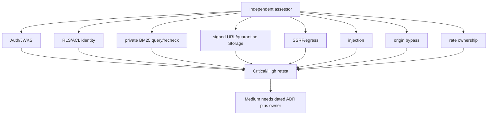

# Phase 10 external assessment scope

This file is **scope only**. It is **not** a penetration-test report, not a
findings log, and not a retest record. Status is **not run**. No independent
assessor has been engaged from this clone. This document does not claim Critical=0.

Phase 9 tar Trivy Critical=0 on the distroless/Alpine freeze is **image
scan, not Packet 7-C**. Trivy is image scan, not Packet 7-C.

Related: [AUTHORIZATION_MODEL.md](./AUTHORIZATION_MODEL.md) ·
[IDENTITY_PROPAGATION.md](./IDENTITY_PROPAGATION.md) ·
[AUTH_RATE_LIMIT_OWNERSHIP.md](./AUTH_RATE_LIMIT_OWNERSHIP.md) ·
[PROTECTED_MIGRATION_CREDENTIALS.md](./PROTECTED_MIGRATION_CREDENTIALS.md) ·
[managed gates](../deployment/MANAGED_STAGING.md) ·
[phase-10 evidence](../development/phase-10-managed-staging-evidence.md)

## Required independent scope (when run)

An independent third-party penetration test or external security review
must cover all of the following against isolated synthetic/redacted
staging only:

| Area | Required proof |
| --- | --- |
| Auth/JWKS | Asymmetric keys, unknown `kid`, standby→active→retired, no HS256 fallback |
| RLS/ACL | Role, ownership, current-version, deletion, and ACL at the authoritative boundary |
| identity | Propagation of server-derived identity; no `user_metadata` authorization |
| private BM25 | Private ParadeDB query construction, stale-candidate recheck in Supabase |
| signed URL / quarantine | Storage signed URL abuse and quarantine-bucket isolation |
| SSRF / egress | Crawl/proxy SSRF, provider-egress deny, parser/ParadeDB no public path |
| injection | Prompt, BM25-query, graph injection, entity-name XSS |
| origin bypass | Direct-origin rejection; CloudFront/WAF/Caddy origin header |
| rate ownership | FastAPI vs Supabase Auth vs WAF ownership; Valkey fail-closed |
| Storage | Bucket policies for originals, quarantine, snapshots, table-artifacts |

## Data and credential constraints

- Synthetic or redacted fixtures only. Production corpus and production
  users are forbidden.
- No long-lived CI, AWS, database, or runtime bootstrap credential may be
  issued to the assessor or committed in Git.
- GitHub OIDC and just-in-time Secrets Manager retrieval remain the custody
  path.

## Finding disposition (when an assessment exists)

- Critical and High findings require remediation and independent **retest**.
- Accepted **Medium** risk needs a **dated ADR** and named **owner**.
- Unowned Medium is a stop. Open Critical/High is a stop.
- Until a real report exists, Packet 7-C stays **Blocked**. Do not invent
  counts.

## Current status

| Item | Value |
| --- | --- |
| Status | **not run** |
| Assessor | none |
| Report path | none |
| Critical open | unknown (not measured) |
| High open | unknown (not measured) |
| Medium owned/dated | none |

Do not copy Trivy output into this file as a substitute report. Do not mark
Packet 7-C Passed from this scope document.
