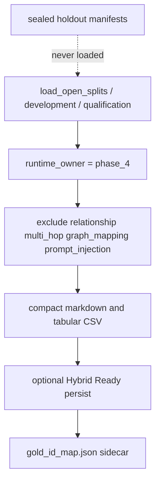

# Phase 4 runtime gold-id sidecar

Holdout-blind mapping from synthetic generator evidence ids to real Hybrid Ready
UUIDs. Compact sources and `gold_id_map.json` are generated by
`scripts/materialize_phase4_eval_corpus.py`. Sealed dataset manifests under
`tests/fixtures/evaluation/phase4/manifests/` are never mutated.

Related: [DATASET_SPEC.md](../../../../../docs/evaluation/DATASET_SPEC.md) ·
[ADR-phase4-engineering-close.md](../../../../../docs/adr/ADR-phase4-engineering-close.md)

## Holdout isolation



The materializer calls only `load_open_splits`, `load_development_cases`, and
`load_qualification_cases`. It does not import holdout access tokens.

## Schema (`phase4-gold-id-map-v1`)

Canonical file: `gold_id_map.json` (generated, gitignored). JSON Schema:
`gold_id_map.schema.json`.

| Field | Meaning |
| --- | --- |
| `schema_version` | `phase4-gold-id-map-v1` |
| `holdout_opened` | Always `false` |
| `runtime_owner` | Always `phase_4` |
| `splits` | `development` and/or `qualification` |
| `case_count` | Distinct open-split cases materialized |
| `records[].synthetic_chunk_id` | Generator id `p4-chk-NNNN` (not a database UUID) |
| `records[].chunk_id` | Real `app.document_chunks.id` after persist; `null` in dry runs |
| `records[].synthetic_table_id` | Generator id `p4-tbl-NNNN` for tabular cases |
| `records[].table_id` | Real `app.document_tables.id` after persist |
| `records[].document_id` / `version_id` | Real canonical ids after persist |
| `records[].visibility` | `restricted` for ACL-negative / restricted-actor gold |
| `sidecar_sha256` | SHA-256 of canonical JSON excluding this field |

Gold chunk ids in `EvaluationCase.evidence_links` are synthetic. Retrieval eval
must join through this sidecar rather than treating `p4-chk-*` as Postgres
UUIDs.

## Generate

Dry run (no Docker):

```powershell
uv run python scripts/materialize_phase4_eval_corpus.py --split development --limit 3 --output-dir tests/fixtures/evaluation/phase4/runtime
```

Live ingest (Packet 8 overlay on host ParadeDB `localhost:54329`):

```powershell
docker compose --env-file .env.compose -f docker-compose.yml -f docker-compose.packet8.yml up -d
uv run python scripts/materialize_phase4_eval_corpus.py --ingest --output-dir tests/fixtures/evaluation/phase4/runtime
```

ACL-negative cases persist with `visibility=restricted` using the labeled
restricted actor. They are not indexed as `company_visible`.

## Failure modes

- Compose down: contract tests skip; the CLI `--ingest` flag exits `2`.
- Wave 1A OpenAI adapter missing: keep `MOCK_MODEL_MODE=true` so
  `create_embedding_gateway` returns the mock adapter.
- Do not copy generated `sources/` or `gold_id_map.json` into sealed manifests.
